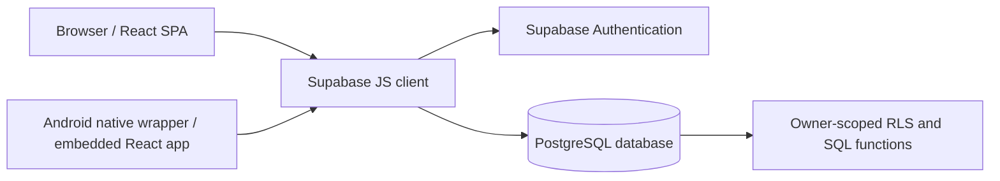
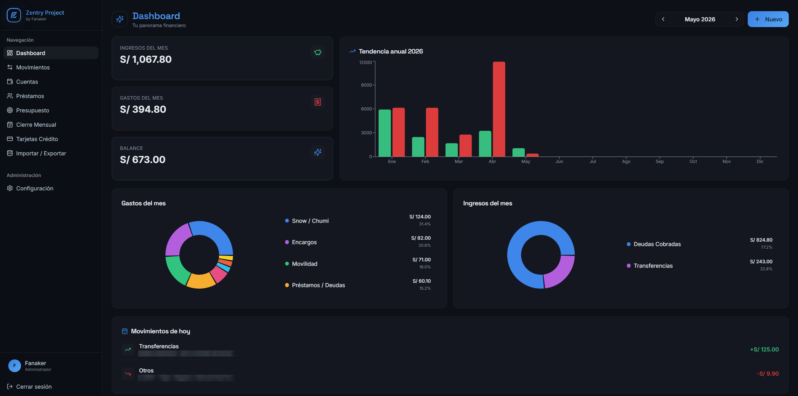
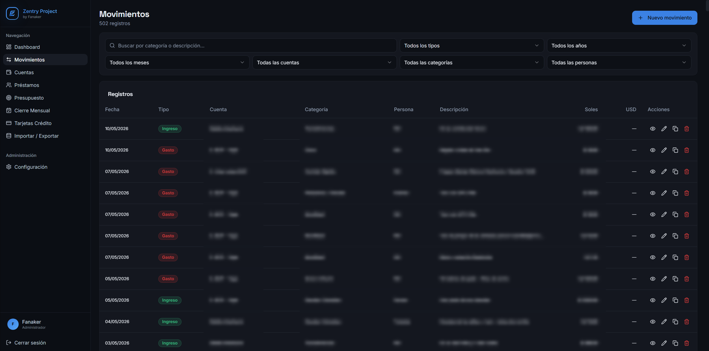
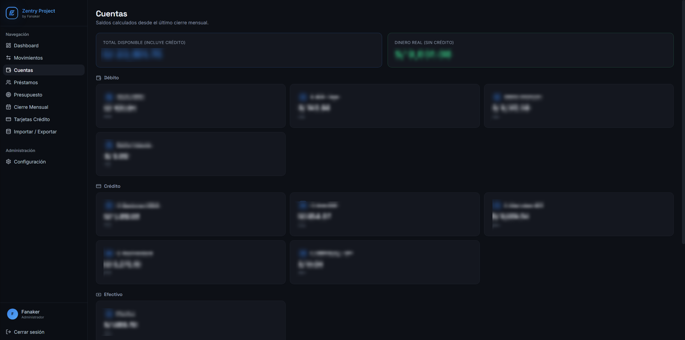
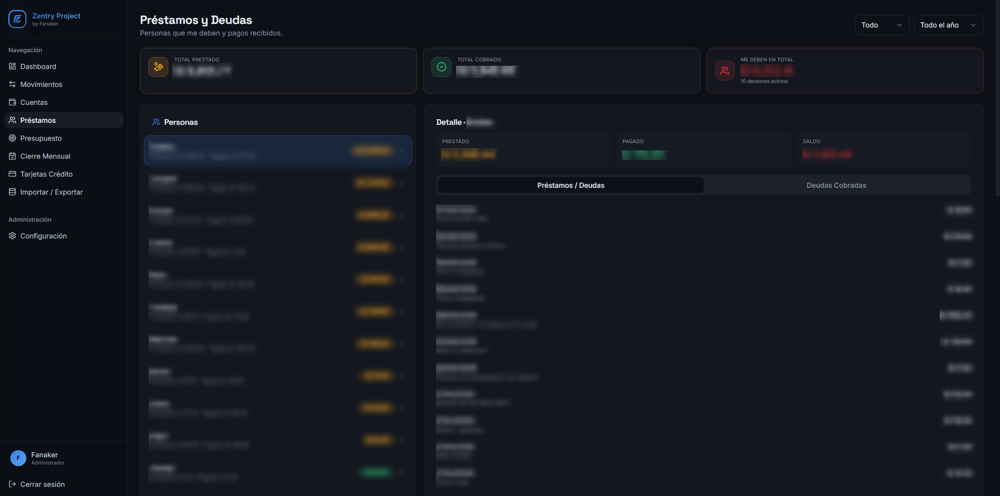
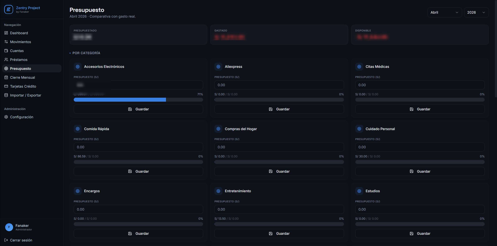
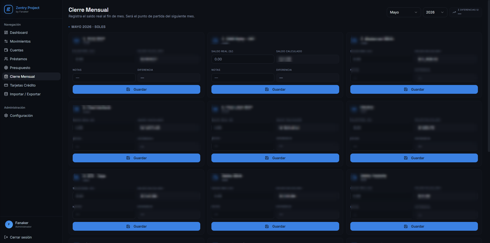
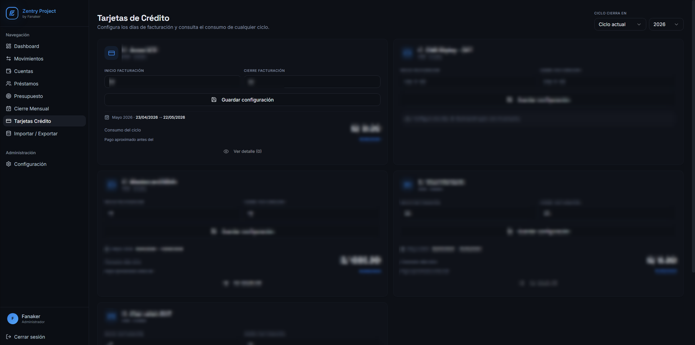
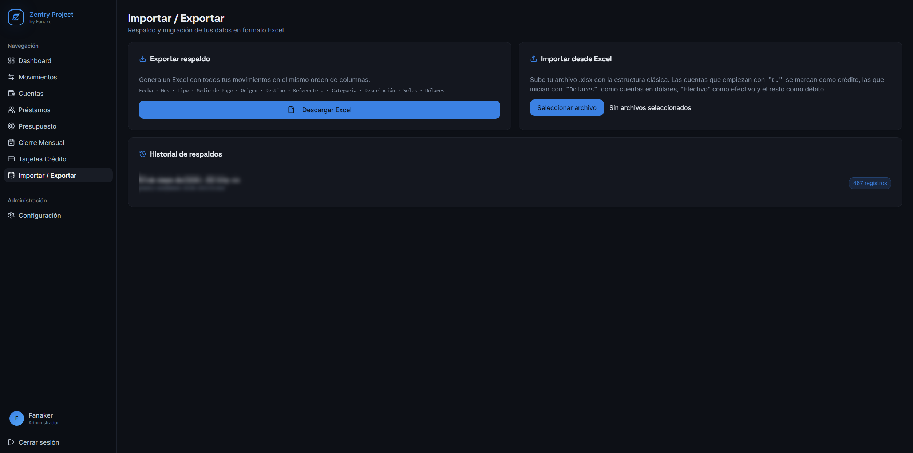
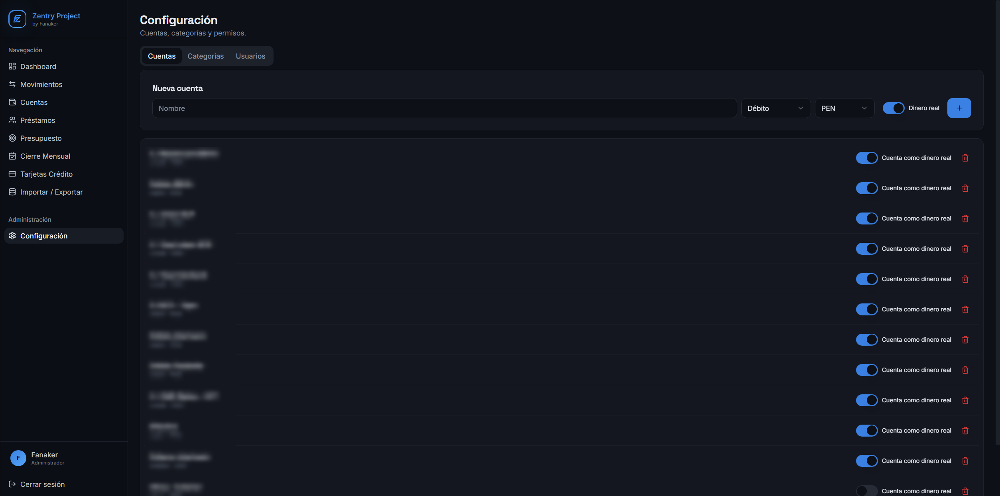

# Zentry — Personal Finance Manager

**Version 2.2.0** · Web + Android · React · TypeScript · Supabase · PostgreSQL

Zentry is a personal finance management application built to consolidate everyday financial activity into a single, responsive workspace. It supports a desktop web experience and a mobile Android app backed by the same Supabase project.

**[Leer en español](docs/README_ES.md)** · [Changelog](CHANGELOG.md) · [Deployment guide](PUBLICAR_WEB.md)

> **Portfolio project.** This repository contains the application's source code, database setup scripts, Android wrapper, and automated tests. It does **not** contain personal financial records, production credentials, APKs, or a public demo account.

## Features

| Area | Capabilities |
| --- | --- |
| Dashboard | Financial overview, income/expense indicators, account summaries and interactive charts |
| Transactions | Expenses, income and internal transfers, with category, account, date, description and reference-person details |
| Accounts | Cash, cards and other accounts; PEN and USD tracking |
| Loans and debts | Record receivables/payables and settlements; printable PDF reports |
| Budgeting | Category budgets and budget-versus-actual tracking |
| Monthly closing | Review and record financial closing information |
| Credit cards | Billing-cycle configuration and transaction analysis (installment purchases are not modeled yet) |
| Data portability | Excel import/export, full personal backup and restore workflow |
| Mobile capture | Draft transactions from Gboard dictation, review before posting, and learn frequently used phrases/aliases |
| Access control | Supabase authentication, per-owner PostgreSQL RLS, account provisioning and optional MFA support |

The Android capture flow uses **Gboard speech-to-text followed by manual confirmation**. It is not presented as a cloud-based AI speech-recognition service.

## Technology stack

- **Frontend:** React 18, TypeScript, Vite, React Router, TanStack Query.
- **UI / visualizations:** Tailwind CSS, Radix UI / shadcn-style components, Recharts, Lucide icons.
- **Backend and persistence:** Supabase Auth, PostgreSQL, Row Level Security (RLS), SQL functions.
- **Import, export and reporting:** SheetJS, jsPDF, html2canvas.
- **Android:** Java / Android Gradle project embedding the compiled web app in an Android WebView; Gboard for dictation.
- **Testing:** Vitest, Testing Library and local PostgreSQL-compatible checks using PGlite.
- **Web distribution:** Cloudflare Pages-compatible static build; no Lovable deployment dependency.

## Architecture



Both clients access the same project using a **public** publishable/anon key. Data authorization must be enforced by Supabase authentication and database policies, not by hiding that public key.

## Repository layout

```text
Zentry/
├── src/                    # React application, pages, hooks, components and tests
├── public/                 # Web icons and static assets
├── android/                # Native Android WebView wrapper and Gradle project
├── database/               # Schema, security hardening and migration SQL
├── scripts/                # Build and database test helpers
├── docs/                   # Spanish README, technical notices and licenses
├── .env.example            # Example PUBLIC Supabase configuration
├── package.json            # Dependencies and project scripts
├── INICIO.md               # Setup guidance (Spanish)
├── PUBLICAR_WEB.md         # Web / Android publishing notes (Spanish)
└── VALIDACION.md           # Validation scope and commands (Spanish)
```

## Local setup

**Requirements:** Node.js 22.12+ (or another version supported by Vite 8), npm, and an **independent Supabase project** if you want to use persistence. Android builds also require JDK 17 and Android SDK 35.

```bash
git clone https://github.com/Fanaker/Zentry.git
cd Zentry
npm ci
npm run dev
```

Open the local URL printed by Vite. On first use, configure the **Supabase project URL** and **public publishable key** on the application's connection screen, or create a local `.env` based on `.env.example`:

```dotenv
VITE_SUPABASE_URL=https://your-project.supabase.co
VITE_SUPABASE_PUBLISHABLE_KEY=your-public-publishable-key
```

**Never commit** `.env`, service-role / secret keys, private signing keys or exports of real financial information. `.env` is ignored by Git.

### Database setup

For a **new, empty Supabase project only**:

1. Execute `database/INSTALL_NEW.sql` using the Supabase SQL editor.
2. Create the intended user in Supabase Authentication.
3. Replace the placeholder UUID in `database/05_provision_owner.sql`, then execute that script to grant access.
4. Review authentication settings and RLS policies before using the application with personal data.

**Do not execute the fresh-install script on an existing Zentry database.** For existing installations, use only the applicable upgrade/migration instructions. See [INICIO.md](INICIO.md).

## Quality checks

```bash
npm run typecheck
npm test
npm run test:db
npm run build
```

Or run the combined pipeline:

```bash
npm run verify
```

The production-ready web assets are generated into `dist/` and are intentionally **not** committed to this source repository.

## Android build

After installing dependencies and setting up Android SDK 35 and JDK 17:

```bash
npm run android:sync
cd android
# Windows: gradlew.bat assembleDebug
# macOS/Linux: ./gradlew assembleDebug
```

`android:sync` builds the web app and copies the output into the native wrapper. Existing installed Android apps can only be upgraded in place with an APK signed with the **same signing key** as the previous release. Do not publish keystores or release credentials.

## Security and privacy

- Financial data is scoped to authenticated owners by PostgreSQL policies (`owner_id`).
- New accounts require explicit provisioning; the repository includes no real user UUIDs.
- Optional MFA and device-access controls are implemented for supported flows.
- Example public configuration is supplied, but no production instance or private database export is bundled.
- The default project setup is **not** a publicly accessible demo. Use your own Supabase test project and synthetic records when reviewing.

## Project status

**v2.2.0 — stable version of the supplied source.** The core finance, capture, reporting and mobile flows are included. Installment-based credit-card purchases and further UI refinements are potential future improvements. See [CHANGELOG.md](CHANGELOG.md) for the release summary.

## License

The application's source is published for portfolio review. **No open-source license has been granted for the application code.** Third-party licensing notices included in the repository remain applicable; see [docs/THIRD_PARTY.md](docs/THIRD_PARTY.md).

---

## Screenshots

Explore the main features of Zentry v2.2.0.

| Dashboard | Transactions |
|---|---|
|  |  |

| Account Management | Loans & Debts |
|---|---|
|  |  |

| Budget Management | Monthly Closing |
|---|---|
|  |  |

| Credit Cards | Import & Export |
|---|---|
|  |  |

### Settings


